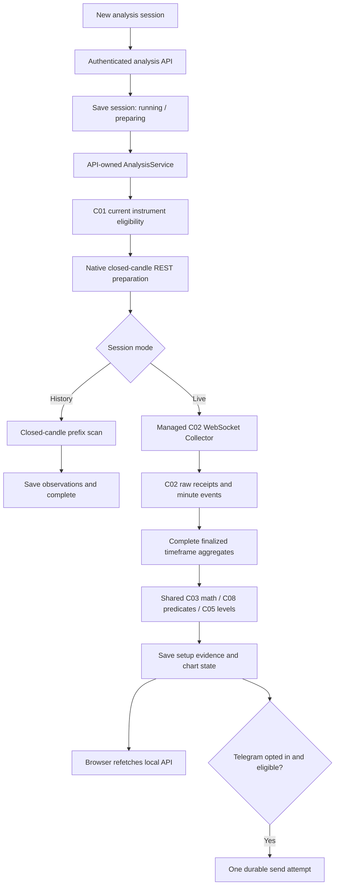

# Quick analysis flow: implementation and extension contract

Reviewed against the implementation on 2 November 2026. This document describes the quick setup-watching path, including the three experimental structural pilots. Their rules and evaluation status are in [the strategy package](../strategies/IMPLEMENTATION_REPORT.md).

For operator instructions, use [Analysis sessions](../user-guide/features/ANALYSIS_SESSIONS.md). For the research-qualified paper workflow, use [Paper sessions](../user-guide/features/PAPER_SESSIONS.md).

## Two independent entry points

| Concern | Quick analysis | Research and paper deployment |
| --- | --- | --- |
| Start | Local recording → Analysis sessions → New analysis session | Prepare datasets, simulations, research evidence and a frozen deployment |
| Purpose | Observe matches to the selected setup rules | Evaluate costs/outcomes, conditional estimates, capital policy and prospective paper behavior |
| Owner | API-owned `AnalysisService` and managed C02 subscriptions | Worker/jobs, independently owned collectors and explicit C14/C15 runners |
| Required user inputs | Name, instruments, one strategy timeframe, supported detectors, live/history mode, optional Telegram | Source/config/model/experiment identities, policies, calendars and deployment bounds |
| Research release | Not required | Compatible C12/C13 evidence required for C14 deployment |
| Multiple strategies | Five detector families can be selected together; structural pilots require BTC/ETH at 15m with automatic 1h context | Current C14 deployment pins one research model/scenario; composed capital policies need their own validation |
| Output | Saved setup observations, chart context and optional observational messages | Simulation/research artifacts, admission decisions, hypothetical fills/outcomes and paper notices |

Quick analysis does not require regeneration of a C12 release. After its own backend/core build changes, create a **new analysis session**. Research/deployment regeneration remains a separate versioned-evidence workflow. Multi-strategy quick watching does not require C14 multi-release composition because analysis creates no funded account or positions.

## Runtime path



REST supplies initial native history and initial/reconnect/gap minute repair. There is no live REST-polling fallback. The browser polls the local API, not Binance: session catalog every three seconds and selected detail every second. The API processes stream wakeups with a one-second per-session supervision cadence; it is not a per-tick trading latency guarantee.

### Preparation and live handoff

1. `AnalysisStore.create` validates and freezes the spec, Telegram destination when enabled, and the backend/core build fingerprint. It records a closed-bar scan boundary with a two-second finalization allowance.
2. `AnalysisService.tick` checks the build and current C01 eligibility. Metadata refresh is requested every 15 minutes; failed eligibility interrupts the session.
3. Legacy detectors prepare **500 native bars live / scan count +420 historically**. Sessions containing structural pilots prepare **6800 native 15m bars live / scan count +6800 historically**, assembling complete hourly context from four contiguous 15m bars. Missing bars are not fabricated. Preparation/history never becomes a notification backlog. Pilot live seeds start after session creation and preserve actual level knowledge clocks.
4. Once every symbol has a watermark, live mode creates one `C02LiveFeed` for that session. Its minute start is the earliest symbol watermark plus the strategy interval. Existing C02 REST repair seeds already closed minutes of the current bucket, then the Collector owns the WebSocket/reconnect loop.
5. The feed persists C02 observations, then projects only events available by its current knowledge cutoff. Every constituent minute must be final and present before it emits a strategy-timeframe candle. Provisional prices can update a separate forming candle only when the current bucket has a contiguous prefix.
6. Evaluation uses closed bars. A gap resets affected contiguous measurements/pending states. Range breakout and EMA20/50 recovery retain 21/397-bar readiness. Structural pilots use the shared native C08 detector, C03 recurrences and C05 strict swing rule, with stable EMA200 execution/hourly context, level history, regime routing, frozen geometry and strict qualification. Readiness does not imply a market opportunity or execution eligibility.
7. A changed closed-bar prefix rebuilds context. A watermark prevents old bars from becoming fresh detections, and a stable setup ID prevents duplicate insertion. Original setup documents remain frozen when a later final-candle correction changes the latest chart.

The analysis evaluator is an adapter over shared definitions, **not a full C08 persisted run or C11 simulation**. Native historical downloads are market-time prefix scans without original historical receive-time evidence. Recorded live aggregates retain C02 event IDs and availability; displayed level records retain `confirmed_ms` and `known_ms`. A late receipt can make knowledge later than market-time confirmation.

## Ownership, storage and versioning

| Source | Responsibility |
| --- | --- |
| [frontend/src/analysis.tsx](../../frontend/src/analysis.tsx) | Form, create/control requests, session selection, API polling, chart focus, detector labels and readiness/delivery text |
| [backend/tradee_web/app.py](../../backend/tradee_web/app.py) | Analysis endpoints, operator authorization, workspace isolation, protected-range checks and service lifespan |
| [analysis.py](../../backend/tradee_web/analysis.py) | Spec validation, analysis SQLite store, API owner, bootstrap, evaluation, lifecycle and observational dispatch |
| [analysis_live.py](../../backend/tradee_web/analysis_live.py) | Managed production C02 Collector, raw persistence, repair, complete-bar/forming projections and stream health |
| [pilot_analysis.py](../../backend/tradee_web/pilot_analysis.py) / [pilot_sources.py](../../backend/tradee_web/pilot_sources.py) | Native pilot adapter, workspace ledgers and asynchronous public clock/calendar preparation |
| [tradee/c08/pilots.py](../../tradee/c08/pilots.py) / [tradee/pilots](../../tradee/pilots/) | Shared structural observations, qualification and dedicated modeled research/capital diagnostics |
| [tradee/c03](../../tradee/c03/) / [c08](../../tradee/c08/) / [c05](../../tradee/c05/) | Mathematical measurements, existing detector definitions and shared level construction |
| [tradee/c14/telegram.py](../../tradee/c14/telegram.py) | Shared HTTP transport only; analysis does not use the C14 deployment/outbox runtime |

One API owner holds `<analysis-store>.lock` with a nonblocking POSIX file lock. Another API process does not start a competing analysis loop. An advanced worker is not involved in analysis processing.

The default analysis store is `data/web.sqlite3.analysis.sqlite3`, derived as `<state_path>.analysis.sqlite3`. It contains sessions, bars/revisions, immutable setups/delivery state, the delivery clock, and workspace-wide `pilot_attempts`, `pilot_bundles`, `pilot_bundle_tags`. Renaming/restarting cannot reset pilot attempts or publication capacity. C01/C02 remain workspace-specific; subscription ownership remains separate while C02 deduplicates identical observations.

Native history downloads are stored in the analysis database. Managed live/repair minute receipts also persist in the workspace's C02 store. Neither process automatically publishes a research dataset, fits C10, creates a C12 release, books C13 capital or populates the advanced C14 Signals ledger. Research snapshots require a separate explicit C02 selection. Reserved C12 ranges remain protected on acquisition and saved analysis reads; quick access does not bypass holdout custody.

The analysis build is `fingerprint([backend build_hash(), trading-core code_hash()])`. A tick refuses a different build and the owner interrupts/pauses that session. Creating a fresh analysis session binds the current implementation while retaining older evidence. Editing stored fingerprints is not a supported migration. A backend restart without a build change pauses running sessions for deliberate resume; a restart does not itself regenerate research.

## HTTP contract

All routes return the usual `{data, meta}` envelope. Mutations use the configured bearer operator token and the existing local host/origin checks. Synthetic workspaces cannot create/control sessions. Analysis reads are workspace-qualified and apply protected-range checks.

| Method and route | Behavior |
| --- | --- |
| `GET /api/{workspace}/analysis` | Catalog plus supported server strategy labels, synthetic flag, Telegram configuration readiness and operator-enabled flag |
| `POST /api/{workspace}/analysis` | Create with required `Idempotency-Key`; same key/body returns the existing session, different body conflicts |
| `GET /api/{workspace}/analysis/{uid}` | Selected session, per-symbol detail, counts and latest 200 saved observations |
| `POST /api/{workspace}/analysis/{uid}/control` | One-key body such as `{"action":"pause"}`; allowed action values are `pause`, `resume`, `stop` |

The create body has exactly these fields; `history_bars` is still required in live mode:

```json
{
  "name": "BTC setup watch",
  "symbols": ["BTCUSDT"],
  "timeframe": "15m",
  "strategies": ["prior_range_breakout"],
  "mode": "live",
  "history_bars": 500,
  "telegram": false
}
```

Allowed timeframes are `1m`, `15m`, `1h`, `4h`, `1d`; history counts are `100`, `500`, `1500`. The server requires uppercase USDT symbols and normalizes duplicate symbols/strategies. The browser uppercases symbol input and sends a new request key for each create action; deliberate creation is different from retrying a request with its original key. There is no session-settings edit endpoint: changed settings require a new session.

## States and notification rules

`state=running` has `preparing`, `waiting_stream`, `warming_up` or `watching` phases. Pause and data interruption stop evaluation; an interrupted phase has paused state and a visible reason. History completes after its scan; live sessions complete at their bound. Stopped/completed sessions cannot resume.

The Binance stream has separate `connecting`, `connected`, `repairing`, `reconnecting`, `waiting`, `stale`, `data_error` or `interrupted` state. A connected source with no message for a symbol produces `waiting`; more than 15 seconds since its last message produces `stale`. Browser/API connectivity does not establish either candle completeness or Binance health.

Notifications require a running live session, explicit Telegram opt-in, a fresh connected source and an unexpired new setup. History/preparation, pause/resume backlog and repaired history do not become new alerts. Source state, suppression cutoff and expiry are rechecked immediately before dispatch. Current detector expiry is exclusive candle end plus `min(300000ms, strategy interval)`; that is an observation lifetime, not a fill promise.

| Saved delivery state | Meaning |
| --- | --- |
| `historical` | Preparation/history/backlog; no send |
| `disabled` | Live observation with Telegram off |
| `pending` / `sending` | Queued / one durable attempt claimed |
| `sent` | Telegram accepted and returned a message ID |
| `failed` | Rejected/failed attempt; no automatic resend |
| `ambiguous` | Acceptance unknown, including an in-flight send interrupted by restart; no automatic resend |
| `expired` / `suppressed` | Too old or disallowed by current control/feed state |

Analysis dispatch shares a 3.5-second minimum attempt interval across its sessions and persists Telegram rate-limit waiting time in its own store. Destination identity is frozen and rechecked. Messages remain silent observations. Pilots include explicitly conditional structural stops/targets and expiry, with a fresh strict qualification recheck before sending; they do not claim fills, account control, measured accuracy or research/live approval.

Pause/stop releases the managed subscription on the owner loop. Other sessions/manual collectors can continue recording. Resume creates a fresh subscription and repairs context while advancing the suppression cutoff. Backend restart pauses active sessions, suppresses pending messages and marks in-flight sends ambiguous. Closing a browser leaves the API owner running.

Bounds: five running sessions, up to five instruments each (pilots restrict the universe to BTC/ETH), 10000 saved candles per instrument, a 500-bar chart viewport, latest 200 observations per detail response and up to 24 hours live from `started_ms`. Reloaded live minute context remains capped at 15000 records; each pilot symbol's execution-path cache is capped at 20000 aggregate trades/five minutes. Cache truncation/gaps cannot certify an uncovered price path. Raw C02 storage is separate from plotting retention.

## Contract for the next pilot-strategy pass

This was the extension contract for the pilot build. The quick entry point remains **New analysis session → Watch live / Scan history**, without mandatory research hashes, releases or account credentials. Current implementation/status:

1. The shared native [C08 observation contract](../../tradee/c08/pilots.py) drives analysis and the dedicated pilot research runner. It retains explicit side/mode, clocks, reasons, hashes and expiry. It does not pretend to be a legacy C02 `CandidateSpec`/C09 intent or a C12 release.
2. Both server validation and frontend choices/readiness now include all three pilots. The form fixes their execution timeframe to 15m and documents their BTC/ETH scope.
3. Native bootstrap and C02-derived closed candles use the same detector and C03/C05 primitives with explicit modeled versus actual receipt knowledge. Historical scans do not invent original receive times. Context is rebuilt deterministically from retained session evidence after restart/repair.
4. Automatic 6800-bar preparation and 10000-bar retention cover at least 1587 stable hourly/execution values and the bounded historical scan. Plot retention is separate. Long prehistory is not inserted into the short live minute cache.
5. Hourly pilot context and EMA200 overlays are automatic. Previous-week seeds/overlays and a generic multi-timeframe C04/C05 store workflow are outside these v1 pilot definitions.
6. Frozen plans retain level/price/context evidence and qualified execution snapshots/hashes. Durable workspace ledgers handle attempts, overlap, cooldown and family caps. Forming candles cannot seed/confirm; recorded trades can invalidate a queued plan intrabar.
7. Only strict qualified pilot observations can notify. Missing/stale official calendars, quotes, marks, metadata, clock or price path block publication. Conditional plans create no account/fill; setup counts remain distinct from modeled backtest outcomes.
8. Correctness, native-history/live-source integration, chronological research and browser checks cover the build. Full recorded-execution validation and advanced C11/C14/C15 promotion remain separate evidence work; see [the implementation report](../strategies/IMPLEMENTATION_REPORT.md).

See [C04 prerequisites](../components/c04/C04_IMPLEMENTATION.md), [C05 prerequisites](../components/c05/C05_IMPLEMENTATION.md), and [the component register](../platform/COMPONENT_UPGRADES.md) for implemented versus deferred scope.

## Verification entry points

```sh
PYTHON_DOTENV_DISABLED=1 python -m unittest backend.tests.test_analysis backend.tests.test_analysis_live -v
TRADEE_PYTHON=python npm run test:e2e --prefix frontend -- analysis.spec.ts
```

Python coverage includes the original analysis checks plus pilot scope/warm-up, receipts, C02 execution streams, workspace controls and independent strategy/research/risk oracles. Browser cases include automatic hourly pilot preparation alongside history/live/mobile behavior. They use the disposable test server on port 8790; see [testing instructions](../user-guide/features/TESTING_AND_TROUBLESHOOTING.md). They send no real Telegram messages and establish no trading edge.

For this documentation review, all **33 analysis/live Python tests passed in 2.376 seconds**. Browser test code was reviewed for the documented user flow; browser E2E and the full platform suite were not rerun for this documentation-only change.
