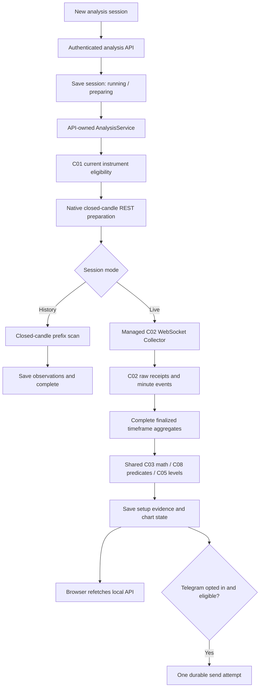

# Quick analysis flow: implementation and extension contract

Reviewed against the implementation on 1 November 2026. This document describes the shipped quick setup-watching path and the integration work to consider before adding the three proposed pilot detectors. It does not define those strategies.

For operator instructions, use [Analysis sessions](../user-guide/features/ANALYSIS_SESSIONS.md). For the research-qualified paper workflow, use [Paper sessions](../user-guide/features/PAPER_SESSIONS.md).

## Two independent entry points

| Concern | Quick analysis | Research and paper deployment |
| --- | --- | --- |
| Start | Local recording → Analysis sessions → New analysis session | Prepare datasets, simulations, research evidence and a frozen deployment |
| Purpose | Observe matches to the selected setup rules | Evaluate costs/outcomes, conditional estimates, capital policy and prospective paper behavior |
| Owner | API-owned `AnalysisService` and managed C02 subscriptions | Worker/jobs, independently owned collectors and explicit C14/C15 runners |
| Required user inputs | Name, instruments, one strategy timeframe, supported detectors, live/history mode, optional Telegram | Source/config/model/experiment identities, policies, calendars and deployment bounds |
| Research release | Not required | Compatible C12/C13 evidence required for C14 deployment |
| Multiple strategies | Existing form accepts either/both implemented detectors in the same analysis session | Current C14 deployment pins one research model/scenario; composed capital policies need their own validation |
| Output | Saved setup observations, chart context and optional observational messages | Simulation/research artifacts, admission decisions, hypothetical fills/outcomes and paper notices |

Quick analysis does not require regeneration of a C12 release. After its own backend/core build changes, create a **new analysis session**. Research/deployment regeneration remains a separate versioned-evidence workflow. Multi-strategy quick watching does not require C14 multi-release composition because analysis creates no funded account or positions.

## Runtime path



REST supplies initial native history and initial/reconnect/gap minute repair. There is no live REST-polling fallback. The browser polls the local API, not Binance: session catalog every three seconds and selected detail every second. The API processes stream wakeups with a one-second per-session supervision cadence; it is not a per-tick trading latency guarantee.

### Preparation and live handoff

1. `AnalysisStore.create` validates and freezes the spec, Telegram destination when enabled, and the backend/core build fingerprint. It records a closed-bar scan boundary with a two-second finalization allowance.
2. `AnalysisService.tick` checks the build and current C01 eligibility. Metadata refresh is requested every 15 minutes; failed eligibility interrupts the session.
3. Initial live preparation requests up to **500 native strategy-timeframe candles per symbol**. Historical scans request **the selected count plus 420 earlier bars**. Missing bars are not fabricated. Preparation may retain recent historical observations, but does not enqueue them for Telegram. Initial live detection scans the last 100 completed bars; earlier bars provide context.
4. Once every symbol has a watermark, live mode creates one `C02LiveFeed` for that session. Its minute start is the earliest symbol watermark plus the strategy interval. Existing C02 REST repair seeds already closed minutes of the current bucket, then the Collector owns the WebSocket/reconnect loop.
5. The feed persists C02 observations, then projects only events available by its current knowledge cutoff. Every constituent minute must be final and present before it emits a strategy-timeframe candle. Provisional prices can update a separate forming candle only when the current bucket has a contiguous prefix.
6. Evaluation uses closed bars. A gap resets the contiguous segment and EMA seed state. C03 numerical primitives and C08 predicates are shared; C05 supplies exact reference definitions. Current detectors are range breakout and EMA20/50 recovery, with 21/397 contiguous-bar readiness respectively.
7. A changed closed-bar prefix rebuilds context. A watermark prevents old bars from becoming fresh detections, and a stable setup ID prevents duplicate insertion. Original setup documents remain frozen when a later final-candle correction changes the latest chart.

The analysis evaluator is an adapter over shared definitions, **not a full C08 persisted run or C11 simulation**. Native historical downloads are market-time prefix scans without original historical receive-time evidence. Recorded live aggregates retain C02 event IDs and availability; displayed level records retain `confirmed_ms` and `known_ms`. A late receipt can make knowledge later than market-time confirmation.

## Ownership, storage and versioning

| Source | Responsibility |
| --- | --- |
| [frontend/src/analysis.tsx](../../frontend/src/analysis.tsx) | Form, create/control requests, session selection, API polling, chart focus, detector labels and readiness/delivery text |
| [backend/tradee_web/app.py](../../backend/tradee_web/app.py) | Analysis endpoints, operator authorization, workspace isolation, protected-range checks and service lifespan |
| [analysis.py](../../backend/tradee_web/analysis.py) | Spec validation, analysis SQLite store, API owner, bootstrap, evaluation, lifecycle and observational dispatch |
| [analysis_live.py](../../backend/tradee_web/analysis_live.py) | Managed production C02 Collector, raw persistence, repair, complete-bar/forming projections and stream health |
| [tradee/c03](../../tradee/c03/) / [c08](../../tradee/c08/) / [c05](../../tradee/c05/) | Mathematical measurements, existing detector definitions and shared level construction |
| [tradee/c14/telegram.py](../../tradee/c14/telegram.py) | Shared HTTP transport only; analysis does not use the C14 deployment/outbox runtime |

One API owner holds `<analysis-store>.lock` with a nonblocking POSIX file lock. Another API process does not start a competing analysis loop. An advanced worker is not involved in analysis processing.

The default analysis store is `data/web.sqlite3.analysis.sqlite3`, derived as `<state_path>.analysis.sqlite3`. It contains `analysis_sessions`, latest native/derived `analysis_bars`, append-preserved `analysis_bar_revisions`, immutable `analysis_setups` with delivery columns, and the shared analysis delivery clock. Each workspace supplies separate C01/C02 paths. Different sessions may subscribe to overlapping symbols; C02 deduplicates identical recorded events, while subscription ownership remains separate.

Native history downloads are stored in the analysis database. Managed live/repair minute receipts also persist in the workspace's C02 store. Neither process automatically publishes a research dataset, fits C10, creates a C12 release, books C13 capital or populates the advanced C14 Signals ledger. Research snapshots require a separate explicit C02 selection. Reserved C12 ranges remain protected on acquisition and saved analysis reads; quick access does not bypass holdout custody.

The analysis build is `fingerprint([backend build_hash(), trading-core code_hash()])`. A tick refuses a different build and the owner interrupts/pauses that session. Creating a fresh analysis session binds the current implementation while retaining older evidence. Editing stored fingerprints is not a supported migration. A backend restart without a build change pauses running sessions for deliberate resume; a restart does not itself regenerate research.

## HTTP contract

All routes return the usual `{data, meta}` envelope. Mutations use the configured bearer operator token and the existing local host/origin checks. Synthetic workspaces cannot create/control sessions. Analysis reads are workspace-qualified and apply protected-range checks.

| Method and route | Behavior |
| --- | --- |
| `GET /api/{workspace}/analysis` | Catalog plus supported server strategy labels, synthetic flag, Telegram configuration readiness and operator-enabled flag |
| `POST /api/{workspace}/analysis` | Create with required `Idempotency-Key`; same key/body returns the existing session, different body conflicts |
| `GET /api/{workspace}/analysis/{uid}` | Selected session, per-symbol detail, counts and latest 200 saved observations |
| `POST /api/{workspace}/analysis/{uid}/control` | One-key body such as `{"action":"pause"}`; allowed action values are `pause`, `resume`, `stop` |

The create body has exactly these fields; `history_bars` is still required in live mode:

```json
{
  "name": "BTC setup watch",
  "symbols": ["BTCUSDT"],
  "timeframe": "15m",
  "strategies": ["prior_range_breakout"],
  "mode": "live",
  "history_bars": 500,
  "telegram": false
}
```

Allowed timeframes are `1m`, `15m`, `1h`, `4h`, `1d`; history counts are `100`, `500`, `1500`. The server requires uppercase USDT symbols and normalizes duplicate symbols/strategies. The browser uppercases symbol input and sends a new request key for each create action; deliberate creation is different from retrying a request with its original key. There is no session-settings edit endpoint: changed settings require a new session.

## States and notification rules

`state=running` has `preparing`, `waiting_stream`, `warming_up` or `watching` phases. Pause and data interruption stop evaluation; an interrupted phase has paused state and a visible reason. History completes after its scan; live sessions complete at their bound. Stopped/completed sessions cannot resume.

The Binance stream has separate `connecting`, `connected`, `repairing`, `reconnecting`, `waiting`, `stale`, `data_error` or `interrupted` state. A connected source with no message for a symbol produces `waiting`; more than 15 seconds since its last message produces `stale`. Browser/API connectivity does not establish either candle completeness or Binance health.

Notifications require a running live session, explicit Telegram opt-in, a fresh connected source and an unexpired new setup. History/preparation, pause/resume backlog and repaired history do not become new alerts. Source state, suppression cutoff and expiry are rechecked immediately before dispatch. Current detector expiry is exclusive candle end plus `min(300000ms, strategy interval)`; that is an observation lifetime, not a fill promise.

| Saved delivery state | Meaning |
| --- | --- |
| `historical` | Preparation/history/backlog; no send |
| `disabled` | Live observation with Telegram off |
| `pending` / `sending` | Queued / one durable attempt claimed |
| `sent` | Telegram accepted and returned a message ID |
| `failed` | Rejected/failed attempt; no automatic resend |
| `ambiguous` | Acceptance unknown, including an in-flight send interrupted by restart; no automatic resend |
| `expired` / `suppressed` | Too old or disallowed by current control/feed state |

Analysis dispatch shares a 3.5-second minimum attempt interval across its sessions and persists Telegram rate-limit waiting time in its own store. This is separate from C14's dispatcher/rate accounting. Destination identity is frozen on creation and rechecked on resume/send. Messages are silent setup observations, containing no fabricated fill, stop/target or research/live approval.

Pause/stop releases the managed subscription on the owner loop. Other sessions/manual collectors can continue recording. Resume creates a fresh subscription and repairs context while advancing the suppression cutoff. Backend restart pauses active sessions, suppresses pending messages and marks in-flight sends ambiguous. Closing a browser leaves the API owner running.

Bounds: five running sessions across the analysis store, up to five instruments each, 2000 saved candles per instrument, a 500-bar chart viewport, latest 200 observations per detail response and up to 24 hours per live session from `started_ms`. The feed also bounds reloaded minute context at 15000 records. Raw C02 storage is not truncated to the chart viewport. Back up both the analysis store and C01/C02 evidence.

## Contract for the next pilot-strategy pass

The intended quick entry point remains **New analysis session → Watch live / Scan history**. Adding exploratory pilot detectors should not introduce mandatory dataset hashes, C12 releases or C14 deployment setup into that form. Costed validation remains available separately. Proposed rules are now documented in [the pilot design package](../strategies/PILOT_STRATEGY_DESIGN.md); none is implemented or selectable yet. The requirements below describe integration, not implementation approval:

1. Define detector semantics in shared core code and reuse them in analysis and research. Extend C08's supported-family/spec/candidate contracts, not only a UI label or an independent web-only predicate. Keep side, timeframe, reasons, expiry and setup identity explicit.
2. Update both server `STRATEGIES`/validation and the frontend detector labels, descriptions and readiness display. The frontend currently renders a local two-family map despite receiving the server catalog; adding a server ID alone will not expose a new checkbox.
3. Provide an explicit bridge for C03/C04/C05 evidence. The quick bootstrap uses native-timeframe candles; canonical engines consume C02 minute events. Native history cannot be inserted as if it were a recorded one-minute prefix. Share formulas, confirmation rules and availability semantics, and label modeled history honestly.
4. Review warm-up and retention before adding EMA200. Live bootstrap is currently 500 bars, history adds 420, and the store cap is 2000. Stable plain EMA200 needs 1582 bars at the existing tolerance; the full C04 slope context needs 1587. A 1500-bar scan plus that warm-up exceeds the current cap. Data preparation, bounds, UI readiness and tests must change together; zero-filling or silently reducing stability is not a solution.
5. Plan higher-timeframe context acquisition explicitly if a detector requires it. The current form selects one execution timeframe; it does not automatically run C04's multi-timeframe preset or materialize C04/C05 CLI stores. Current analysis indicators are EMA20/50, and its C05 display subset is prior range, previous UTC day and one recent swing per side. EMA200, previous-week overlays and richer context are not already enabled here.
6. Persist each setup's original context/level versions and confirmation/knowledge clocks. Stateful sweep/retest detection must recover deterministically, reset/suppress appropriately across gaps and repairs, and retain duplicate/correction behavior. Forming candles remain display-only. Different detector matches currently have separate IDs; overlap labels do not establish independent confirmation or shared portfolio admission.
7. Preserve observational message wording and dispatch controls. Entry/exit policies and measured outcomes belong to explicitly defined later work. Analysis setup counts cannot be relabeled win rates or funded returns.
8. Extend history/live integration and browser checks for the new detectors, including warm-up, missing data, future-prefix exclusion, corrections, restart, pause/resume suppression and one-attempt delivery. Add equivalent research/replay checks when connecting the detectors to C11/C14.

See [C04 prerequisites](../components/c04/C04_IMPLEMENTATION.md), [C05 prerequisites](../components/c05/C05_IMPLEMENTATION.md), and [the component register](../platform/COMPONENT_UPGRADES.md) for implemented versus deferred scope.

## Verification entry points

```sh
PYTHON_DOTENV_DISABLED=1 python -m unittest backend.tests.test_analysis backend.tests.test_analysis_live -v
TRADEE_PYTHON=python npm run test:e2e --prefix frontend -- analysis.spec.ts
```

The Python suites cover spec/idempotency/auth, historical/live behavior, real C02 Collector processing through scripted network seams, finality/gaps/repairs, availability and level timing, metadata, reserved ranges, storage, ownership controls and delivery failures. The three existing browser cases cover historical scan/focus, live controls/stream/forming state, and workspace/mobile isolation. Browser checks use the disposable test server on port 8790; see [testing instructions](../user-guide/features/TESTING_AND_TROUBLESHOOTING.md). Tests do not send real Telegram messages or establish profitable strategies.

For this documentation review, all **33 analysis/live Python tests passed in 2.376 seconds**. Browser test code was reviewed for the documented user flow; browser E2E and the full platform suite were not rerun for this documentation-only change.
