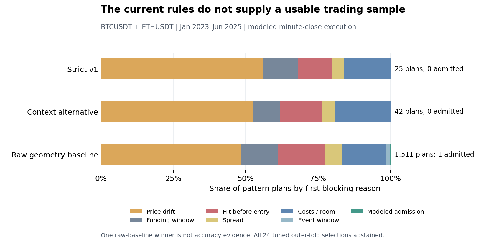

# Structural pilots: implementation and evaluation

**2 November 2026 — experimental observations and modeled research.** This report supersedes the earlier “design only/not selectable” implementation status. The original v1 specifications remain the frozen reference. Implementation does not establish a trading edge or a live release.

## What is implemented

- Three selectable Analysis families: liquidity sweep, 200 EMA rejection and key-level retest. Sweep trend-pullback and range-edge modes remain separately measured.
- Closed-bar causal state machines with C03 SMA-seeded EMA/Wilder ATR recurrences, the shared C05 strict swing primitive, completed UTC-day levels, known-time approaches, immutable accepted-break context, level episode/attempt limits, hourly persistence and frozen range geometry.
- Structural tick-rounded stops/targets, expiry/drift limits, costed room and net reward/risk checks. Strict qualification checks current recorded quotes/marks, sequence-checked contract trades, metadata, clock measurement and official event coverage. Evidence and its hash are retained with the assessment.
- Workspace-wide SQLite attempt/bundle/tag ledgers survive session renaming/restarts. Qualified overlap plans use the fixed family priority; successful Telegram delivery is not required to consume observation capacity. Existing one-attempt transport behavior remains.
- Automatic preparation from at least 6800 native 15m candles, with complete hourly candles assembled from four contiguous closed 15m bars. Historical scans add their requested scan length. Storage is bounded at 10000 candles per instrument; pilot chart payloads retain the latest 500 and include EMA200.
- A dedicated versioned research runner with checksum/source audits, modeled minute-close execution, actual historical settlement rates under a declared projected schedule/mark proxy, fees/slippage/spread stress, ablations, geometry/state neighbors, chronological training-only selection and shared-capital replay.
- A research-only balanced context alternative. Its fixed differences were committed before evaluation in [the experiment addendum](CONTEXT_PROFILE_V2_EXPERIMENT.md). It is not an automatic default or release change.

Native pilot observations have a dedicated [C08 contract](../../tradee/c08/pilots.py). They do not masquerade as legacy C02 `CandidateSpec`/C09 intents. The existing advanced C08–C15 release workflow retains its prior families and evidence requirements; this work does not grant a C12 release or create a portfolio deployment.

## Use the quick flow

Restart the backend/frontend with the updated build, then create a **new** analysis session. Existing sessions are pinned to their prior build and cannot be resumed across a code change.

Choose BTCUSDT and/or ETHUSDT, select any of the three pilots, and choose Watch live or Scan history. The form sets 15m execution automatically; hourly context requires no additional form inputs. Preparing sufficient context can take longer than the legacy detectors. A newly learned level must also have the required complete post-knowledge approach; cold startup does not backdate its availability.

Readiness means measurements are prepared. Market-state and execution checks can still block a setup. History scans use a declared modeled clock and show price-pattern observations, not historical fills, accuracy or net profitability. Strict live qualification never silently falls back to candle-only evidence. Calendar/clock preparation status is visible; saved pattern evidence records why qualification was blocked.

Pilot collectors additionally subscribe to public quote, aggregate-trade and mark streams through the existing C02 collector. Their bounded trade cache detects ID gaps; reconnect/repair clears execution-path eligibility and suppresses backlog. Native history stays separate from the short live minute cache. Public calendar/time preparation runs asynchronously and requires no account credentials.

Direct BLS HTTP retrieval returned 403 during this implementation, although the official annual schedules were available to the research browser. Historical schedule facts are retained as **reconstructed final schedules**, with explicit provenance. This is not fresh live calendar coverage. If official live retrieval remains unavailable or coverage becomes stale, strict alerts remain blocked; no empty-calendar assumption is used.

## Reproduce the experiments

The protocol is [pilot_research_v1.json](../../configs/pilot_research_v1.json), with the [v2 addendum](CONTEXT_PROFILE_V2_EXPERIMENT.md). Price/funding acquisition covers October 2022–June 2025: three months of prehistory, then January 2023–June 2025 development. All 198 monthly archives were checksum-verified. July–December 2025 price archives were not acquired/read by this work. Prior inspection is unattested, so that reserved period is not certified untouched evidence.

```bash
python3 -m tradee.pilots.archive --minutes
python3 -m tradee.pilots.comparisons --output data/pilot-research/verified-v2 --workers 2
```

Use a new output directory after an implementation change. The run manifest pins all core Python source, Git commit, protocol/calendar hashes and permitted raw archive checksums/receipts. Caches reject incompatible evidence. Large public source archives stay under ignored `data/`; code, protocol, reports and Git history provide the reproducible version trail.

Every mode gets six chronological quarterly outer tests from January 2024 through June 2025, with the preceding 12 months for selection and a 24h purge plus holding-horizon maturity exclusion. Only earlier training can choose among the three original geometry scales and the one registered context alternative. Training requires at least 30 resolved modeled entries, a positive mean, and the frozen drawdown-penalized score; otherwise that fold abstains. Unknown outcomes cannot be dropped to pass selection.

Reporting includes the 54 original comparison recipes, four training-selection recipes and four context alternatives: **62 planned new recipes**, with the unknown historical TBot/Tradee trial count disclosed. No adjusted significance claim assumes that historical count was zero. All variants share strict-v1 point-in-time audit regimes for marked P&L; their own strategy labels remain separate.

## Results and verification

The initial baseline diagnostic at `cb8855b` produced 24 trend-sweep plans and one retest plan across BTC/ETH, with zero modeled admissions. EMA rejection and range-sweep modes produced no plans. The geometry neighbors likewise admitted no entries. Win rate is undefined; this is insufficient evidence, not a profitable zero-drawdown strategy.

The first wider comparison run exposed a pending-EMA/null-level coexistence bug in the raw baseline and was not completed. It is retained as a failed run, not a passing backtest. Commit `4026348` fixed the bug and added a regression test, causal receipt-time checks and raw calendar evidence.

### Completed evaluation at `760f2bb`

The [complete versioned report](results/2026-11-02-pilot-report.json) pins run `a4c25a93cd16032ca06ad434773b11187a3c79ef97ab17c9cb1c75e45a7a6024`, core implementation `b8c9e5ad50fbc229483e2d2462094c33026646d024514ede02d4f50fe9ec374a` and raw-source manifest `c53a1b68104028eef52c14eb05e141ee2d3f5d57dfd88ac6c597635eaba3aa1f`. Local detailed cohorts, common regime timelines and receipts remain in `data/pilot-research/verified-v2/`.

| Mode | Strict-v1 plans | Context-alternative plans | Modeled admissions, strict / alternative | Selected outer-fold entries |
| --- | ---: | ---: | ---: | ---: |
| Liquidity sweep — trend pullback | 24 | 39 | 0 / 0 | 0 |
| Liquidity sweep — range edge | 0 | 1 | 0 / 0 | 0 |
| EMA200 rejection — trend | 0 | 1 | 0 / 0 | 0 |
| Key-level retest — trend | 1 | 1 | 0 / 0 | 0 |
| **Total** | **25** | **42** | **0 / 0** | **0** |

All six folds for each of the four modes abstained: **24 of 24 mode/fold selections had no eligible training variant**. Original geometry/state neighbors and both quality-filter ablations likewise admitted zero modeled trades. The predeclared fee, slippage, 60s/120s delay and combined stress cases also admitted none. Flat modeled equity with no exposure supplies no evidence of profitable/range-safe trading. Win rate remains undefined.

The raw-geometry baseline, which removes regime/dull/exhaustion quality filters, generated **1511 plans and one modeled admission**: an ETHUSDT retest closed by its three-hour time limit on 5 December 2024, with **+0.264285655609 R** under the declared costs. Its apparent 100% win rate has **N=1**, no loss sample and no useful accuracy evidence. It is not a selectable winner. The separate raw range case produced no plans. Shared-capital replay of that one raw case ended at 10005.662995 modeled units from 10000, with approximately 0.15445% sampled marked drawdown; neither figure validates the strategy.

Strict v1's 25 plans were first blocked by price drift (14), funding horizon (3), a protective level reached before entry (3), spread (1), and cost/remaining room (4). The context alternative's 42 were blocked by drift (22), funding (4), pre-entry level hits (6), spread (2), and cost/room (8). These are first-blocking-reason counts, not independent causal attributions.



**The requested good-accuracy outcome was not achieved.** The frozen rules are over-constrained under this execution model, and the context alternative did not resolve the entry/room bottleneck. Even perfect execution of all alternative EMA/range/retest plans would leave those modes far below the frozen sample requirement. More threshold searching cannot establish accuracy from that inventory.

The first eligible minute close approximates a 30-second reaction delay with at least minute resolution, so 30s and 60s may share an assessment price. This can miss opportunities available at an actual 30s executable quote. These diagnostics therefore do not prove intrinsic unprofitability; finer execution evidence and a sufficiently populated detector hypothesis are needed before further performance selection. No configuration was activated or promoted from these results.

### Correctness and UI checks

| Check | Result |
| --- | --- |
| Full core regression at frozen source | **867 passed**, 749.555s |
| Full backend suite | **85 passed**, 57.151s |
| Frontend unit tests | **11 passed** |
| Browser end-to-end suite | **14 passed**, including automatic pilot context/timeframe/history and existing live/mobile flows |
| Frontend production build | Passed |

The 37 new core pilot tests include independent long/short geometry/cost expectations, C03 batch equivalence, C05 pivot/receipt parity, known-time and level exhaustion, pending-state coexistence, delayed/ambiguous execution, shared-wallet loss limits, training-only selection, and a common regime audit that cannot be relabeled by a candidate classifier. Seven new backend tests cover scope, long warm-up, native/live knowledge, rebuild parity, durable workspace controls and real C02 execution-event ingestion. Browser data is synthetic; the market diagnostics use the audited public archives. Neither kind of check sends real Telegram messages.

## Interpretation and remaining evidence

Minute-close prices, spreads, slippage, historical rule scope and schedule knowledge are modeled assumptions. Contract closes proxy settlement marks when needed. Historical quotes/receipts are not invented. Ambiguous stop/target minutes remain unresolved; a separate stop-first adverse scenario does not become a mature profit label. All strict net/maturity/release fields remain unavailable or false.

The finite-capital replay starts from the committed 10000-unit model default, uses all-in stopped-loss sizing, current notional limits, one shared BTC/ETH risk group and the specified daily/weekly/campaign pauses. Unknown exits retain risk and stale exposure. Marked P&L includes positions carried from trends into dull/ranging/transition periods. Gap overshoots remain losses rather than being capped at a circuit-breaker threshold.

Actual fee/impact/manual-latency calibration, complete recorded execution/calendar/rule evidence, attested untouched final validation and prospective paper observation remain prerequisites for a validated release. The design's 60-day/50-entry forward requirement cannot be established by an historical replay. A high small-sample win rate, if any, cannot override these requirements.
